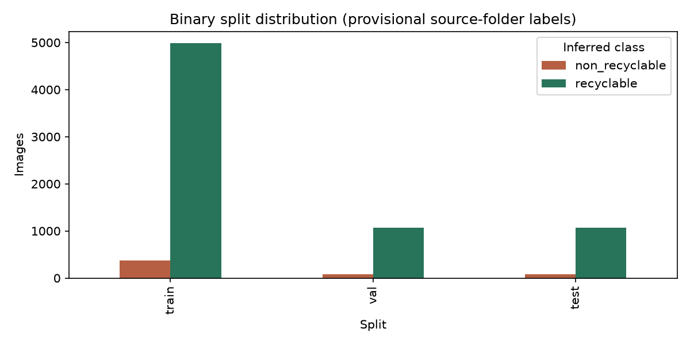
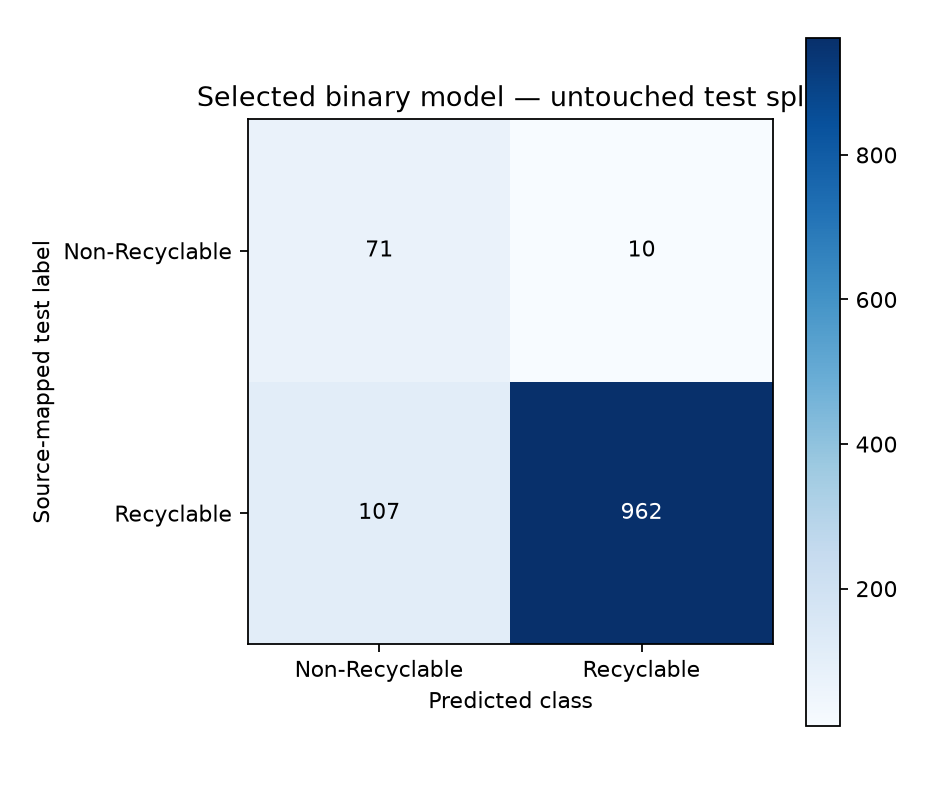
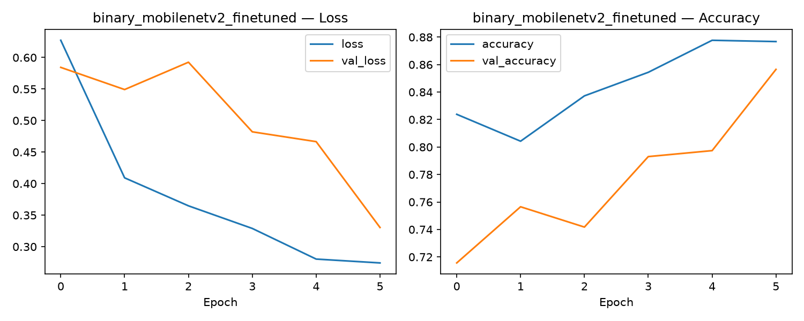
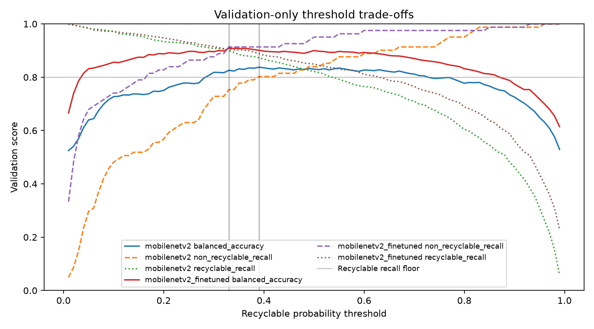

# Binary Recyclable / Non-Recyclable Experiment

**ITM 360 AI • Group 4 • Run date: 2026-11-19**

## Label provenance and limitations

This is a genuine two-output classifier. Binary training targets are mapped from the original
dataset folders: cardboard, paper, glass, metal, plastic → `recyclable`; `trash` →
`non_recyclable`. All **7,664 labels used here are provisional source-folder mappings**; zero
binary labels have been human-verified. Metrics below measure agreement with that mapping,
not verified recyclability or local collection acceptance.

The previous human review queue remains unreviewed. A representative visual check flagged
TrashNet `trash100.jpg` as possibly showing recyclable paper; it is excluded from this binary
run without changing its source label. Exact source-label conflict groups remain quarantined;
101 unresolved near-duplicate candidates were excluded upstream. No other images were
individually adjudicated.

## Dataset and split counts

| Inferred class | Total | Share | Train | Validation | Test |
| --- | ---: | ---: | ---: | ---: | ---: |
| Recyclable | 7,126 | 92.98% | 4,988 | 1,069 | 1,069 |
| Non-Recyclable | 538 | 7.02% | 376 | 81 | 81 |
| **Total** | **7,664** | **100%** | **5,364** | **1,150** | **1,150** |

The seed-42 split keeps capture groups intact. No images were copied into validation/test or
oversampled there. Class weights were computed only from the training split. See
`data/processed/binary_split_manifest.csv`, `binary_split_counts.csv`, and
`binary_summary.json` for row-level provenance and verification checks.

## Minority-class investigation and validation-only selection

The first binary run used balanced class weights (Non-Recyclable weight 7.13 vs Recyclable
0.54) but selected the decision threshold by validation macro F1. That threshold favored
Recyclable detection and yielded only 42% Non-Recyclable recall on the prior held-out result.
The overall accuracy concealed this because the test labels are 93% Recyclable.

I fine-tuned the top 20 MobileNetV2 layers from the preserved binary baseline at learning
rate 1e-5, froze batch-normalization layers, and doubled the training-only Non-Recyclable
class weight. For model/threshold choice, I used validation balanced accuracy with a constraint
that Recyclable recall remain at least 80%; macro F1 and Non-Recyclable recall break ties. The
held-out test set was not used to select the model or threshold.

| Candidate | Validation threshold | Balanced accuracy | Macro F1 | Non-Recyclable recall | Recyclable recall |
| --- | ---: | ---: | ---: | ---: | ---: |
| MobileNetV2 baseline | 0.39 | 0.838 | 0.693 | 0.802 | 0.873 |
| MobileNetV2 upper-layer fine-tune + 2× Non-Recyclable weight | 0.33 | 0.909 | 0.761 | 0.914 | 0.905 |

The fine-tuned candidate was selected using validation only. Its model is
`artifacts/models/binary_mobilenetv2_finetuned.keras`; inference uses the 0.33 recyclable
probability threshold in `artifacts/model_manifest.json`. The original binary baseline is
preserved at `artifacts/backups/binary_mobilenetv2_pre_tuning.keras`; the original six-class
model remains at `artifacts/models/mobilenetv2.keras`.

## Selected model: one held-out test evaluation

After selection, the fine-tuned model was evaluated once on the 1,150-image public test set
at threshold 0.33. Against provisional source-mapped labels:

- Accuracy: **89.83%** (always-Recyclable baseline: 92.96%)
- Balanced accuracy: **88.82%** (always-Recyclable baseline: 50.00%)
- Macro precision: **69.43%**
- Macro recall: **88.82%**
- Macro F1: **0.745**

| Class | Precision | Recall | F1 | Support |
| --- | ---: | ---: | ---: | ---: |
| Non-Recyclable | 0.399 | 0.877 | 0.548 | 81 |
| Recyclable | 0.990 | 0.900 | 0.943 | 1,069 |

Confusion matrix (rows = source-mapped true class, columns = predicted class; order:
Non-Recyclable, Recyclable):

|  | Predicted Non-Recyclable | Predicted Recyclable |
| --- | ---: | ---: |
| True Non-Recyclable | 71 | 10 |
| True Recyclable | 107 | 962 |

The new threshold substantially raises Non-Recyclable recall while preserving 90% Recyclable
recall. It also raises false Non-Recyclable predictions (107 source-mapped Recyclable images),
and Non-Recyclable precision is only 39.9%. The model is not suitable as an authoritative
disposal decision system. Source labels are unverified and test support for Non-Recyclable is
only 81.

Machine-readable validation sweeps, selected test metrics, and per-image predictions are in
`artifacts/metrics/binary_*_validation_threshold_sweep.csv`,
`binary_validation_model_comparison.csv`, `binary_final_evaluation.json`, and
`binary_final_test_predictions.csv`. The earlier binary baseline evaluation files are
historical and are not used for current selection.

## Hardware and local evaluation

Runs used Python 3.11.16, TensorFlow 2.21.0, macOS 26.1 arm64, 10 CPU cores, 16 GiB RAM, and
no TensorFlow GPU. The fine-tuning run completed three epochs in 143.0 seconds of recorded
model-fit time. The baseline MobileNetV2 and Custom CNN training records remain available for
comparison; settings and hardware are recorded in `artifacts/metrics/binary_*_train.json`.

There are no Cambodian local evaluation images. The bot's image workflow was exercised with
real held-out images through the saved binary model and a simulated Telegram message handler;
no connection to Telegram was made because no private token is configured.

## Dataset supplement decision

The Mendeley Waste Classification Dataset is CC BY 4.0, but labels `organic` and `recyclable`,
so its organic class is not a valid substitute for residual non-recyclable waste. The separate
dataset advertised as manually labeled `Recyclable`, `Non-Recyclable`, and `Hazardous` has no
license for its image files documented on the accessible repository page, so it was not
downloaded or used. Adding data with a mismatched target or unclear reuse rights would not
improve the validity of this run.

## Bot readiness

The existing bot is now wired to the selected two-output binary model. It returns one of the
two requested labels, confidence, a threshold-based low-confidence warning, and general
guidance with a local-acceptance reminder. Automated and simulated image-handler tests pass.
For live Telegram polling, configure `TELEGRAM_BOT_TOKEN` privately in `.env` and run
`.venv/bin/python -m waste_ai.bot`. No token was requested or written by this run.
