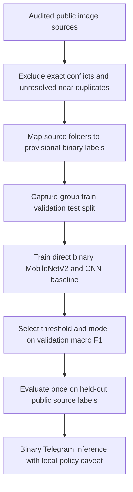

# Direct binary waste image classification

## Research target and labeling policy

The output is one of two classes: `recyclable` or `non_recyclable`. For the present
public-data experiment, the target labels are **provisionally inferred from the source
folders**: cardboard, paper, glass, metal, and plastic map to recyclable; `trash` maps to
non-recyclable. These source annotations are not human-verified recycling decisions.
Material appearance alone cannot establish an item's cleanliness, the collector's accepted
material types, or local recycling rules. The 600-image human review queue remains unreviewed;
the training labels must not be described as verified ground truth.

A representative spot-check flagged TrashNet `trash100.jpg` because its image appears to
show crumpled paper. It was excluded from the binary pool without changing or relabeling the
original. Exact cross-label conflict groups were quarantined in the earlier audit; the 101
unresolved near-duplicate candidate images are excluded upstream. Other source labels and
condition are not individually verified.

## Data and split

Use the existing staged public sources and the one-resolution candidate manifest. The
binary pipeline reuses the six-class audit's cleaned image paths, source provenance, hashes,
and capture groups. It creates `data/processed/binary_split_manifest.csv` without copying
image data. Mapping is direct from the source label to a two-class training target; the old
six-class model head is not used.

| Source-derived binary label | Images | Proportion |
| --- | ---: | ---: |
| Recyclable | 7,126 | 92.98% |
| Non-Recyclable | 538 | 7.02% |
| Total | 7,664 | 100% |

Class groups are assigned independently to train/validation/test, targeting 70/15/15 while
keeping every capture group within a single split. Exact duplicates were deduplicated and
unresolved near duplicates were excluded before this mapping. The fixed seed is 42.

| Split | Non-Recyclable | Recyclable | Total |
| --- | ---: | ---: | ---: |
| Train | 376 | 4,988 | 5,364 |
| Validation | 81 | 1,069 | 1,150 |
| Test | 81 | 1,069 | 1,150 |

## Training and selection

MobileNetV2 uses the saved six-class MobileNetV2's frozen ImageNet feature backbone as a
local initialization with a direct two-neuron binary softmax head. The binary baseline uses
balanced class weights computed from train labels only. A candidate fine-tunes the upper 20
backbone layers at learning rate 1e-5, keeps batch-normalization frozen, and doubles the
Non-Recyclable training class weight. The Custom CNN baseline is initialized from scratch.
Models use aspect-preserving 224x224 RGB input, training-only augmentation, batch size 32,
and early stopping on validation loss (patience 2).

The binary threshold is chosen on validation probabilities by maximizing balanced accuracy
while requiring at least 80% Recyclable recall. Macro F1 and Non-Recyclable recall break ties.
Models are compared with the same validation criteria. The held-out test set is not used for
threshold selection or model selection. The selected fine-tuned model uses a 0.33 recyclable
probability threshold.

## Evaluation

Evaluate on 1,150 public test images with accuracy, precision, recall, macro F1, balanced
accuracy, per-class metrics, and a confusion matrix. The held-out test target labels are also
source-folder-derived and unverified, so these numbers measure agreement with that mapping,
not the correctness of local disposal decisions. The test set contains 1,069 recyclable and
81 non-recyclable labels. An always-Recyclable baseline therefore has 92.96% accuracy and
50% balanced accuracy. The selected fine-tuned model measures 89.83% accuracy, 88.82%
balanced accuracy, and 0.745 macro F1. It identifies 71 of 81 non-recyclable test labels,
while marking 107 recyclable test labels as non-recyclable. This tradeoff still requires
caution, especially because the test labels are unverified source-folder mappings.

No independent Cambodian local images are available. No local test score is reported. Softmax
confidence is not calibrated certainty, and local collection acceptance may differ from the
source categories.

## Flow

## Dataset supplement check

No external dataset was added. The [Edge Hill/Mendeley Waste Classification Dataset](https://data.mendeley.com/datasets/n3gtgm9jxj/3)
is CC BY 4.0 and has `organic` versus `recyclable` labels, but organic waste is not the same
as the project's residual non-recyclable class; mapping it would silently change the research
target. Another [repository dataset](https://github.com/goreatharva/Recyclable-NonRecyclable-Hazardous-Waste-Dataset)
advertises 720 non-recyclable, 742 recyclable, and 744 hazardous images, but its GitHub page
does not document an image license; it was not copied into this project.

## Preserved six-class experiment

The six-class model and prior report remain intact as a research artifact/backup. Their six-way
results are not binary results and are not used by the binary Telegram prediction path.
